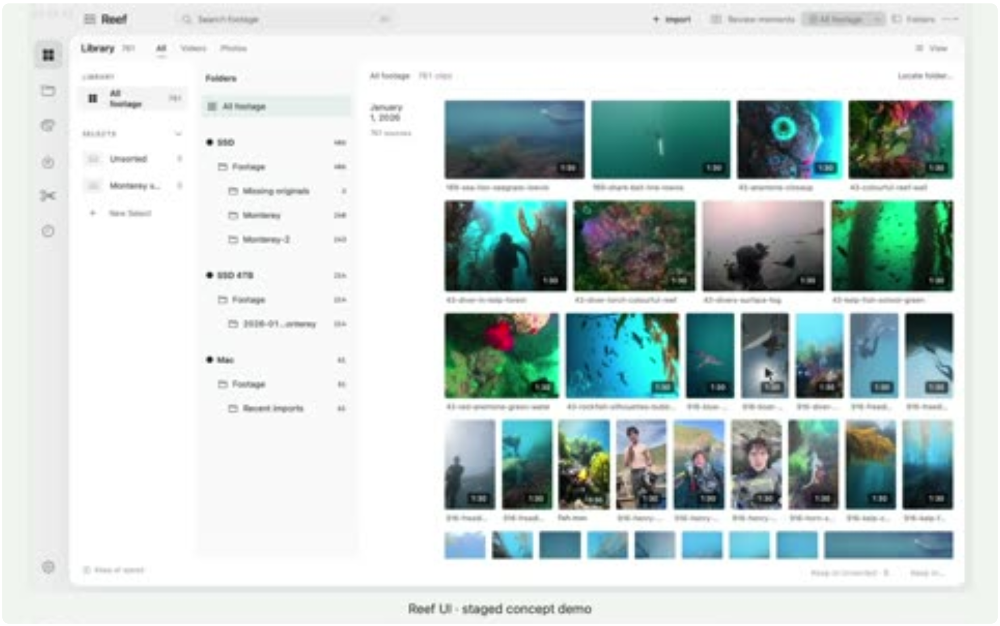
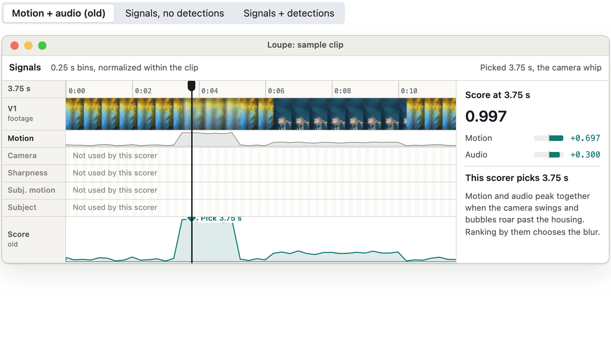
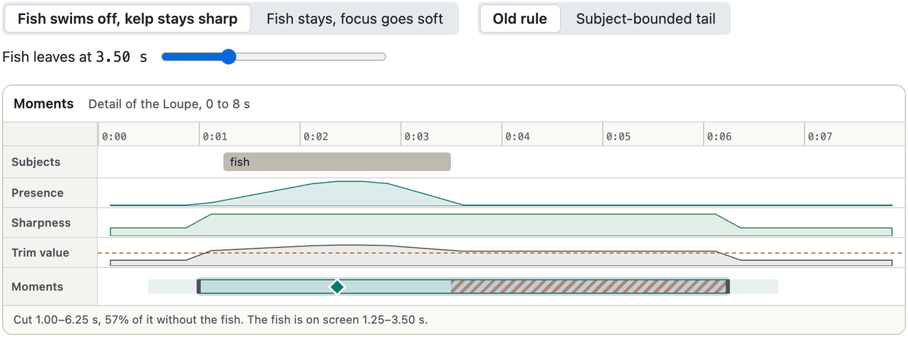
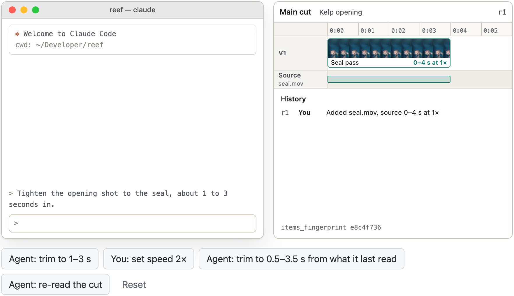
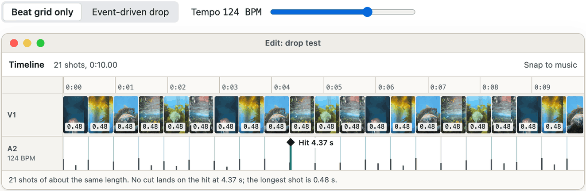
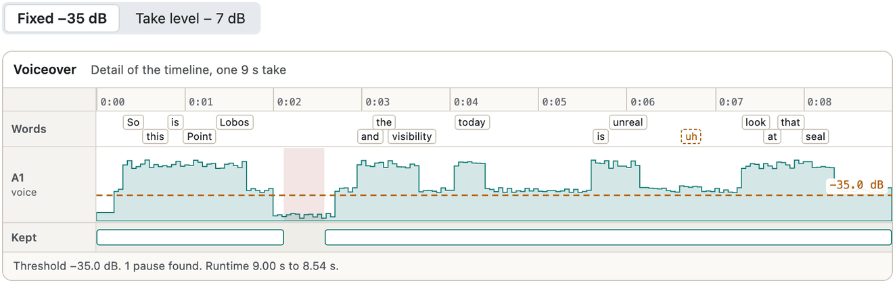

# Reef

**A native Mac editor that finds the moments in hours of dive footage, and lets an agent edit the same timeline I do.** I come back from a dive with hours of GoPro footage and maybe forty good seconds. Reef finds them, keeps every cut tied to the source frames it came from, and gives an assistant the same operations the app uses. When I'm done, it hands an editable timeline to DaVinci Resolve.

<p align="center"></p>

<sub>Put together from real Reef interface captures and Catalina footage, with a prepared conversation. It isn't one continuous live session; a screen recording replaces it next.</sub>

## Why dive footage is hard

Most highlight finders look for motion and loud audio. Underwater, those signals point the wrong way. The busiest second of a clip is usually the camera whipping around, blurred and full of bubbles. The shot I want is held still: a seal in focus, close to the middle of the frame. Reef's engine is built around that difference.

The figures below come from interactive rebuilds in Reef's own design system, not from Reef itself. Each rebuild runs a small JavaScript port of one engine subsystem, with its real weights and thresholds, on sample signals.

- [Whip or hero](#whip-or-hero): camera motion and subject motion are measured separately
- [Where the cut goes](#where-the-cut-goes): a cut ends when the animal leaves
- [One timeline, two editors](#one-timeline-two-editors): the agent and I write to the same saved cut
- [Cutting to a drop](#cutting-to-a-drop): the beat grid sets the timing, the music sets the cuts
- [Tightening a voiceover](#tightening-a-voiceover): dead air goes, words stay whole
- [Telling the model where I dove](#telling-the-model-where-i-dove): a measured accuracy gain from location

## Whip or hero

On one of my clips, Reef measured that motion and sharpness were **anti-correlated**. The bin with the most motion was the blurriest one, a camera whip. The sharpest bin had almost no motion. So Reef computes optical flow and splits it in two: camera motion from the border of the frame, and subject motion as whatever moves differently from the camera. It adds focus and subject presence, then subtracts a penalty when the camera is moving and the frame is blurred at the same time. Switch scorers, then drag the playhead to see why each second scores the way it does.

<p align="center"></p>

```text
score = 0.7·motion + 0.3·audio
```

<sub>The weights are Reef's defaults in <code>moment_signals.py</code>. The signals are samples shaped like the measured case, and the footage lane uses stills from my own clips placed to match them. Subject presence is detector confidence times closeness to the centre of the frame. Box size is left out on purpose, so a small seal I'm following counts as fully present.</sub>

## Where the cut goes

Finding the peak is only half the job; the in and out points matter just as much. Reef's first rule trimmed a cut on a blend of subject presence and sharpness. On one clip the fish left at about 3.5 s, but the kelp stayed sharp, so the cut ran on to 5.25 s and 78% of it showed no fish. On another the opposite happened: the cut ended while the subject was still in frame. Now one module places every cut. **A trailing second can only be trimmed if it's weak and the subject is gone, and a cut never runs past the subject's exit.**

<p align="center"></p>

The kelp is still sharp after the fish leaves, so the blended value stays above the trim line and the cut keeps running. The hatched part is footage with no fish in it. This is a sample shaped like that clip, so its numbers differ from the measured 5.25 s and 78%.

<sub>From <code>moment_window_policy.py</code>. It trims on the blended value at 0.6 times the span's peak (the dashed line). Presence of 0.10 or more counts as the subject being in a bin. The minimum cut is 2 s, and the pale band is the 0.5 s handle on each side. The function never raises: bad input still comes back as a sane cut. Before this, hysteresis splits a clip into usable spans: a span opens at 0.35 and stays open down to 0.22, dips of up to 2 s are bridged, and spans under 2 s are dropped. A skipped range is recorded with its reason.</sub>

## One timeline, two editors

The cut doesn't live in the chat. It lives in Reef as saved revisions, and the agent edits it through the same engine operations as the app. Every write carries the fingerprint of the cut it saw. If I changed the cut in the meantime, the write is refused, and nothing is silently overwritten. Let the agent trim, change the speed yourself, then let the agent write again from what it saw before.

<p align="center"></p>

<sub>The tool names and arguments are Reef's MCP tools, <code>get_storyboard</code> and <code>edit_storyboard</code>. A write passes <code>expected_items_fingerprint</code>; a stale one comes back as <code>operation.conflict</code> and writes nothing. The ids, the conversation and the fingerprints (computed by this page) are samples.</sub>

## Cutting to a drop

Cutting on every beat looks mechanical, like a metronome. In Reef's editing grammar, **the beat grid only sets the timing; it isn't the reason to cut.** In a percussive drop, Reef finds the strongest hit and gives it a real cut, even off the grid. It snaps nearby cuts to onsets within 120 ms, then picks cuts outward from the hit with gaps that grow 35% at each step. Shots get shorter going into the hit and longer after it. Change the tempo and compare.

<p align="center"></p>

<sub>From <code>music_grammar.py</code> and <code>music.py</code>. Reef builds a music map from decoded samples: an onset envelope gives the tempo, beats and novelty events, and RMS energy gives the sections. The base shot length is clamped between 0.30 and 0.50 s, and a cut lands 80 ms after its hit. A vocal drop reverses the density. A song with no section evidence falls back to the beat grid, and Reef says so. The onsets here are a sample song; the shot frames are stills from my clips.</sub>

## Tightening a voiceover

My note after an early voiceover cut: "there are still some weird silent moments." Word timings couldn't find them, because Whisper stretches each word's end over the pause after it. So Reef measures the audio itself. A fixed −35 dB threshold failed too: breath and room tone sit above it, so real pauses never registered as silence. **The threshold now follows the take: its own level minus 7 dB, clamped between −40 and −28 dB.** A cut that would clip the start of a word shrinks to stop just before it, and it's dropped if too little is left.

<p align="center"></p>

Breath and room tone sit around −32 dB, above the fixed line, so only the one truly dead hole counts as silence. The pauses after "Lobos", "today" and "unreal" all survive.

<sub>From <code>vo_tighten.py</code>, with <code>split_span</code> ported exactly. It runs ffmpeg <code>silencedetect</code> inside each kept span and counts only pauses of 0.45 s or more, so a natural breath survives. Each cut keeps 0.12 s of padding on the speech side. The rewrite runs in one write transaction, and replaced spans stay as flagged rows, because the engine never deletes. The take is a sample with a breath floor around −32 dB.</sub>

## Telling the model where I dove

When Reef asks a vision model to describe a moment, it adds the dive's location and a regional species shortlist. In the October 5 bake-off, this was the biggest single accuracy gain. **The region comes only from the catalogued dive site, never from the trip name.** I write trip names myself, and they can give the answer away. The shortlist is a hint, not a fixed list: the prompt tells the model to report what it actually sees.

| Prompt context, Sonnet 5.5 | Described correctly |
| --- | --- |
| No location | 38 of 52 |
| Location line and regional shortlist | **44 of 52** |

```python
>>> location_context("Point Lobos")
{'dive_site': 'Point Lobos',
 'region': 'Monterey Bay, central California: kelp forest and rocky reef',
 'shortlist': 'harbor seal, California sea lion, sea otter, giant Pacific octopus, red octopus, ...'}
# The trip name ("cabo mako shark") is never passed in: it would name the answer.
```

<sub>Measured on 52 clips I labelled myself, as recorded in <code>moment_regions.py</code>. The call above is the real function's output, with the shortlist shortened.</sub>

## How it fits together

One rule holds it together: **only the engine writes the catalog.** The app reads, the agent asks, and both go through the same operations.

| Layer | What it does |
| --- | --- |
| Mac app | SwiftUI, with AppKit where it needs it. Reads the catalog through GRDB and asks the engine for every change, so a button and an agent run the same operation. |
| Assistant over MCP | Claude Code, Codex or Reef's own assistant call 138 tools: query the catalog, inspect moments, draft a storyboard, revise it. |
| Python engine | The only writer. Owns analysis, editing, validation, rendering and the search index, behind a library lock. |
| SQLite catalog | Assets, captures and their versions, moments, cuts, research. An original, its proxy and later derivatives stay linked, so a proxy never stands in for the original at export. |
| Analysis | Gemini-first analysis of proxies, with local MLX models on Apple silicon for motion, tracking, embeddings, detection and speech. |
| Moments and search | Moments carry corrected geometry and exact source ranges. A separate local producer builds them from signals, and the two are always named apart. |
| Render | A proxy render for review, a master render for delivery. Each attempt is bound to its source, cut and settings. |
| DaVinci Resolve | Builds an editable, versioned timeline through Resolve's scripting API, after checking its project and frame rate, and keeps the link to the source frames. |

## Built to be driven by an agent

| Tools | Tier | What happens |
| --- | --- | --- |
| 114 | Free | Search the library, inspect moments and transcripts, draft and revise storyboards. |
| 11 | Ask first | The tool's own description opens by telling the agent to ask me before it runs. |
| 13 | Hard gate | Claude Code prompts me on every call, in every permission mode, with no "don't ask again". |

Every tool states its side effects in the first 512 characters of its description, where agents weigh text most. Saved taste rules, favourite sounds, caption styles and looks can go into later requests, so the agent starts from what I've already decided. The model plans and proposes; the project state stays in Reef.

## Rules the engine keeps

Reef can run unattended across a whole library, so most of its complexity goes into not claiming more than it knows. When the evidence doesn't hold up, it stops with an error instead of guessing.

| Rule | In practice |
| --- | --- |
| **Nothing is deleted** | Re-runs and corrections flag old rows as superseded, retired or retracted. The evidence behind a removed item stays in the catalog. |
| **Exact time** | Frame rates and time bases are stored as fractions and mapped under an explicit rounding policy. If a file's coded and average frame rates disagree by more than 0.5%, its timing isn't trusted for exact mapping. |
| **Capture isn't container** | A clip shot at 120 fps may already be conformed to 24 fps, so the file's rate is never taken as the capture rate. Speeds below 1× are refused until a verified playback decision exists. |
| **Confidence has a ceiling** | Water facts (blue or green cast, low light, haze) use a fixed vocabulary, come from a single frame, and are capped at 0.5 confidence. |
| **Whole-clip sweep** | Detection sweeps the whole proxy at about 1 fps and links detections into per-subject tracks, so an animal crossing a quiet stretch still gets found. |
| **Find similar** | "More like this" searches the SigLIP vectors stored at ingest, with no new model call. Each hit comes back with in and out points, ready for a storyboard. |

## Inside

- A SwiftUI and AppKit app for macOS 15+, reading a local SQLite catalog through GRDB
- A Python engine that owns every catalog write, media operation and search index
- An MCP server with 138 tools in three permission tiers
- Originals, proxies and derivatives kept linked as captures and their versions
- Storyboards with revisions and conflict checks; proxy renders for review, master renders for delivery
- A DaVinci Resolve push that builds an editable timeline bound to the catalog
- Read-only bridges to Social Lab research and COOPR's Content Brain

## Notes

Everything above exists in source. Client coverage and full end-to-end acceptance are still in progress, and there's no public release yet. A successful preview render isn't a verified final delivery. Grade Lab is a related tool with its own Resolve toolchain, not a built-in grading panel. The source is private; the moment finder and the timeline revert are explained in [reef-algorithm-studies](https://github.com/henryhcooperr/reef-algorithm-studies).

## Related

- [henryhcooperr profile](https://github.com/henryhcooperr)
- [reef-grade-lab](https://github.com/henryhcooperr/reef-grade-lab)
- [reef-social-lab](https://github.com/henryhcooperr/reef-social-lab)
- [coopr](https://github.com/henryhcooperr/coopr)
- [reef-algorithm-studies](https://github.com/henryhcooperr/reef-algorithm-studies)
